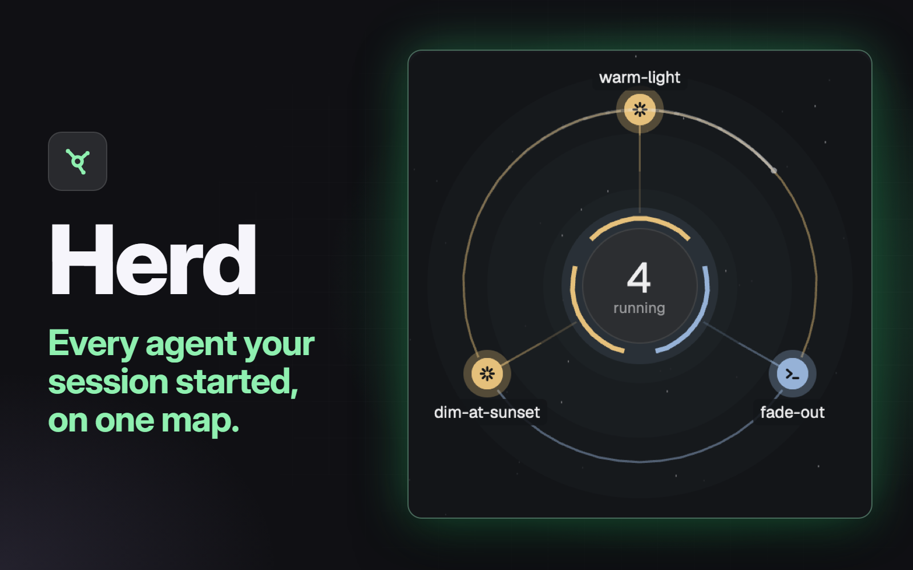

# Herd

A side panel for Herdr with a map of everything a Claude Code session started, and a row per agent saying what it's doing.

A mod for the [Herdr](https://github.com/ogulcancelik/herdr) desktop app, split out of [Orchi](https://github.com/adamentwistle/orchi-build) so it works on its own. Built and run on macOS.

Ask your agent to add it from [herdr.dev/mods](https://herdr.dev/gallery/?type=mods), or point it at this repo. It reads [the recipe](RECIPE.md) and every file first.

`scripts/check-drift.py` lists where this copy differs from Orchi's.

MIT, see `LICENSE`.
